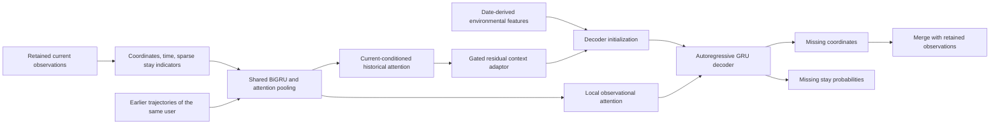

# Architecture and manuscript correspondence

This document maps the implementation to the revised manuscript's BAMTR design. Mathematical structure and implementation choices are distinguished explicitly. Tensor dimensions use `H` for one encoder direction, `D = 2H` for its concatenated output, and `S` for the decoder hidden size.

## Information flow



## Attribute module: Section 4.1

The point representation combines normalized coordinates in `[latitude, longitude]` order, within-day seconds divided by 86,400, and an embedding of the observed stay/move indicator. That indicator is recomputed after downsampling and does not use withheld coordinates.

Environmental context has five raw values in this implementation:

1. The first retained observation's time of day, expressed as a fraction of 24 hours.
2. The weekday index divided by six, with Monday equal to zero.
3. A one-hot working/non-working/unknown calendar status.

The last item contributes three dimensions. The environmental projection and mobility projection use the configured embedding widths, defaulting to 30, with Tanh activation. Weather is omitted at the user's request. Choosing the first retained observation to summarize the global hour is an implementation convention because the manuscript does not identify one unique trajectory-level hour.

## Shared encoder: Equations (1)-(10)

The same bidirectional GRU and pooling parameters encode the current sparse trajectory and every historical trajectory. Padded positions are masked before attention normalization. Learned attention pooling produces one vector for each trajectory rather than selecting only its last state.

The default `encoder_hidden_size: 128` is the size of each direction. The concatenated representation has 256 features. `decoder_hidden_size` is separately configurable and defaults to 256. Increasing the number or length of historical trajectories increases work and memory use but does not instantiate additional encoders.

`configs/bamtr_40_h256.yaml` provides a separate interpretation with 256 units per encoder direction and a 512-unit decoder. Neither interpretation is claimed to recover an unspecified original implementation solely because its parameter count is close to a reported value.

Dropout is explicitly applied to encoder and decoder inputs and outputs so that `dropout: 0.5` has an effect even when `num_layers: 1`. With multiple layers, recurrent inter-layer dropout is also enabled. The precise external dropout locations are an implementation choice; PyTorch's inter-layer recurrent dropout alone would be inactive for a one-layer GRU.

## Historical attention: Equations (11)-(12)

The current pooled representation is the query. Separate learned query and key projections produce scaled dot-product attention over the earlier personal trajectories. The values are the historical representations themselves. Invalid history slots are excluded from the softmax.

Only dates before the target date may enter this memory. The main configurations require at least one valid historical day. A no-history configuration is an explicit ablation or fallback experiment, not evidence that cold-start performance has already been validated.

## Context adaptor: Equations (13)-(16)

The adaptor follows the manuscript's fused-state residual gate:

```text
fused = tanh(W_fuse [current ; history] + b_fuse)
gate = sigmoid(W_cross fused + b_cross)
adapted = fused + fused * gate
```

The gate acts on the fused representation. This formula is not replaced with an alternative convex mixture of current and historical vectors. Attention weights and gates are learned quantities; their presence alone does not establish that the retrieved history is semantically correct.

## Decoder: Equations (17)-(24)

The adapted representation and environmental embedding initialize the decoder. The first retained coordinate and its observed mobility indicator provide the initial autoregressive inputs, as specified in the revised manuscript.

Each step attends to the retained current observations using additive attention. After the initial step, the decoder consumes the previous missing-point output, local observational context, and an embedding of the previous predicted stay probability. Decoder output and local context feed a two-layer coordinate head with an intermediate ReLU and a semantic linear head. Coordinate output is not clipped to the training range; the semantic probability is the sigmoid of its logit.

The revised manuscript specifies `L_miss` decoding steps. The implementation therefore generates missing points only, in the order of their requested timestamps. Retained points are merged into the final trajectory rather than regenerated and scored as missing points.

### Query time is an explicit design choice

Equation (22) does not list the current query timestamp as a decoder input. Accordingly, `query_time_conditioning: false` preserves that input contract. Query timestamps still define the ordering and alignment of predictions. With other model inputs unchanged, changing only query intervals while retaining the same query count does not provide additional timing information to this default decoder.

`query_time_conditioning: true` adds explicit timing information. Use a separate run and label it as a time-conditioned extension; do not report it as an unchanged implementation of Equation (22).

## Training objective: Equations (25)-(26)

Coordinate and semantic losses are evaluated on valid missing targets only. Padding is excluded. Coordinate squared errors are calculated in normalized coordinate space; reported geographic errors are calculated after inverse normalization.

Teacher forcing is a training mechanism. Its probability decreases linearly from 0.8 to 0.3 over the default 30 epochs. Validation, evaluation, and prediction use autoregressive decoding without ground-truth missing coordinates as decoder inputs. Reference semantic labels are likewise excluded from inference inputs.

The exact loss reductions and any implementation choices needed to resolve incomplete manuscript details are recorded in [reproducibility.md](reproducibility.md).

## Configuration switches

The model exposes `use_history`, `use_context_adaptor`, `use_mobility`, `use_environment`, and `use_local_attention`. These support controlled experiments. A switch should be described by its actual effect on inputs, supervision, parameter sharing, and inference, rather than assigned a manuscript ablation name without checking those details.

Disabling `use_context_adaptor` replaces its learned gated fusion with current-plus-history addition. Disabling `use_history` uses the current representation alone. Samples without valid history also use the current representation. These are defined implementation conventions, not independently verified reproductions of named paper ablations.

Disabling mobility inputs is different from disabling the auxiliary semantic loss. Use `training.lambda_semantic` to control the latter and document both choices.
